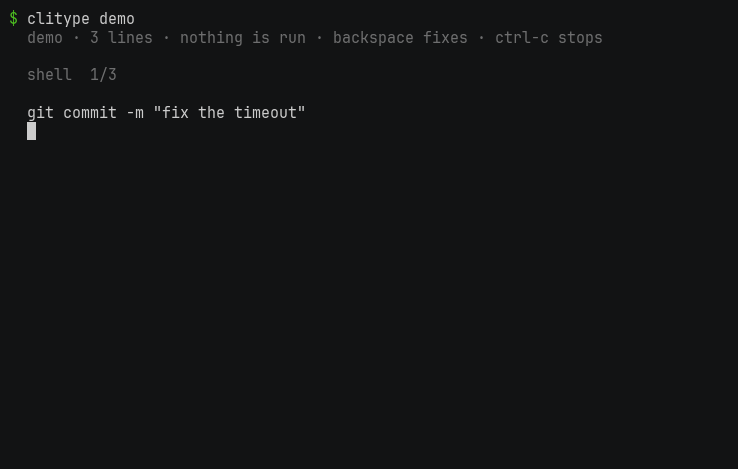

# clitype

Practice typing in the terminal. Shell commands, and short messages like the ones you write to an LLM.

I was learning a new layout and doing well using Monkeytype, Typelit.io, and various other typing sites, but that didn't translate very well to command line interactions. So I wrote this to practice that.



Nothing you type is executed.

## Install

```
go install github.com/madhermit/clitype@latest
```

## Use

```
clitype              # 10 lines, shell and chat mixed
clitype shell        # commands, flags, paths, pipes
clitype chat         # short messages
clitype shell 20     # a longer session, up to 100
clitype demo         # the three lines in the recording
```

The line to type stays put. What you type appears under it, and the part you have already matched dims. A miss is red. Backspace fixes it. Ctrl-C stops and prints the session.

[demo.cast](demo.cast) is the asciinema recording in the gif above.

## License

MIT
